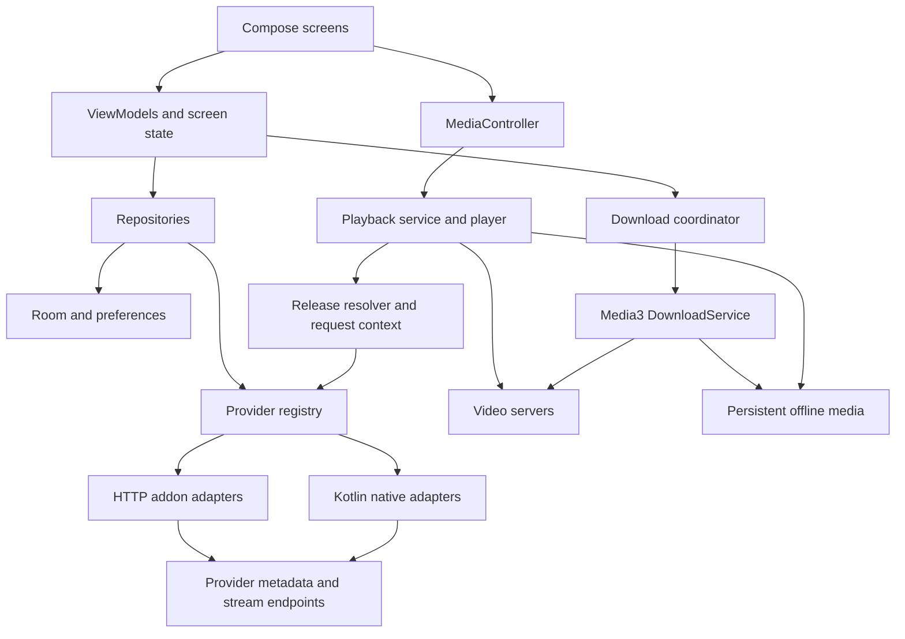

# Architecture: NiceTime Android

Date: 2026-09-15. Status: target architecture, partially implemented. The Android Gradle project is at the workspace root. Confirmed scope: NiceTime, a multi-provider YouTube-style movie/series viewer distributed as a personal APK, with offline downloads and no initial accounts. Sources should cover worldwide, multiple-language use through independently verified adapters/addons. Read [decisions](README.md#decision-register), [PRD](PRD.md), [tasks](TASKS.md), and [gates](PHASE_COMPLETION.md).

## 1. Architectural decisions

| Decision | Choice | Reason and reconsideration trigger |
| --- | --- | --- |
| Client platform | Native Kotlin, Compose, coroutines/Flow | Fits Android media lifecycle and requested stack |
| Initial topology | Android client calls configured providers directly | No first-release account/server dependency; revisit for owned catalog or sync |
| State | ViewModels expose immutable screen state; repositories own data | Keeps UI independent from parsing and service lifecycle |
| Playback | One Media3 player/session owned by a playback service | UI can rotate or navigate without owning the player |
| Downloads | Media3 offline engine with persistent state | One download engine, separate from UI lifecycle |
| Persistence | Room for app records, DataStore for preferences, Media3 index for transfer state | One authoritative writer per type of data |
| Provider code | Kotlin adapters initially | Reuse Rust behavior and fixtures; avoid JNI/build complexity until profiling justifies it |
| Growth | Modular Android app; optional modular backend later | Add deployment complexity only for measured needs |

Use Android's [architecture guidance](https://developer.android.com/topic/architecture) as the baseline for UI/data separation. Specific limits, schemas and rollout choices below are project proposals.

## 2. Runtime topology



The client fetches metadata and resolved URLs, then transfers media directly from the video host. A future account backend stores user state; it does not automatically proxy video. This separates account traffic from bandwidth-heavy media delivery.

## 3. Project layout and dependency direction

Proposed root: `android-app/`. P0 confirms monorepo versus standalone repository. Preserve the existing Rust files.

Proposed application ID: `app.nicetime.android`, finalized in T-002 before issuing the first signed build. User-visible label: NiceTime. Debug builds use an application ID suffix so they can coexist with the personal release APK.

```text
android-app/
  app/                    application, navigation, dependency wiring, feature packages
    .../feature/home/
    .../feature/search/
    .../feature/details/
    .../feature/library/
    .../feature/downloads/
    .../feature/settings/
  core/model/             provider-independent Kotlin types and contracts
  core/data/              repositories, Room, preferences, HTTP client, adapters
  core/media/             player/session, download engine, cache, request contexts
  benchmark/              added in performance phase
  gradle/libs.versions.toml
  docs/                   build/run and architecture decision notes
```

Initial Gradle modules: `:app`, `:core:model`, `:core:data`, `:core:media`. Feature folders stay packages until build times, ownership, or isolated delivery justify extracting `:feature:*` modules. Do not generate dozens of empty modules.

Dependency rules: app may depend on all core modules; data and media depend on model contracts; model has no Android, UI, Room or Media3 dependency. Media obtains a `ReleaseResolver` through injection, not a dependency on data implementation. App wiring binds interfaces to implementations. UI never imports provider DTOs or directly opens database/network connections.

## 4. Technology selection and version policy

| Area | Proposed component |
| --- | --- |
| UI | Compose, Material 3, Navigation Compose, adaptive layout utilities |
| Presentation | Lifecycle ViewModel, StateFlow, lifecycle-aware collection |
| HTTP/JSON | OkHttp plus Kotlin serialization; HTML parser only when native scraper added |
| Images | Coil with bounded memory/disk cache and sized requests |
| Local data | Room, DataStore, Android Keystore-backed credential encryption |
| Media | Media3 ExoPlayer, HLS/DASH modules, Session, offline APIs |
| Persistent maintenance | WorkManager for metadata refresh and future sync |
| Dependency wiring | Constructor injection; Hilt for Android lifecycle bindings |
| Quality | JUnit, coroutine tests, HTTP fixture server, Compose/device tests, Macrobenchmark |

Proposed min SDK 26. At P0 pin mutually compatible stable Kotlin, AGP, JDK, Compose and Media3 versions using official release documentation. Set compile/target SDK for the selected release channel at implementation time. No unverified version number is a requirement in this pack. Record dependency licenses and generate a reproducible dependency inventory.

## 5. Provider contract and identity

The current [Rust provider contract](../../src/providers/mod.rs) is the starting point. Keep asynchronous operations and capability discovery, but support multiple installed instances of the same addon.

Conceptual Kotlin contract, to be finalized with concrete result types in T-005:

```kotlin
interface ContentProvider {
    val instanceId: ProviderInstanceId
    val capabilities: ProviderCapabilities
    suspend fun catalog(request: CatalogRequest): Page<MediaSummary>
    suspend fun search(request: SearchRequest): Page<MediaSummary>
    suspend fun details(ref: MediaRef): MediaDetails
    suspend fun streams(ref: EpisodeRef): List<Release>
    suspend fun resolve(ref: ReleaseRef, purpose: ResolvePurpose): ResolvedStream
}
```

- `ProviderInstanceId`: installation UUID; endpoint and credentials stored separately. Two installations of one addon cannot overwrite each other.
- `MediaRef`: provider instance + provider-native ID + media type. Never key solely by title or playback URL.
- `EpisodeRef`: media reference plus provider episode ID and optional season/episode numbers. Movies have an explicit movie variant; avoid invented episode zero.
- `ExternalId`: verified namespace/value such as IMDb/TMDB for optional cross-source matching. Uncertain matches stay separate.
- `ReleaseRef`: episode reference, provider release locator, rendition/track selection and source configuration revision. Retained for re-resolution.
- `ResolvedStream`: URI, MIME hint, permitted request-host scope, request-context reference, expiry if known, subtitles, selected tracks and source label. Sensitive header values remain in an isolated credential/request-context store.
- Capabilities include catalog/search/pagination, stream resolution, download eligibility, external subtitles, supported media types and live/VOD distinctions.
- `ProviderFailure`: timeout, network unavailable, rate limited with retry hint, auth expired, not found, unsupported, parse failure, source unavailable. Preserve coroutine cancellation; never convert it into ordinary failure.

Metadata cannot claim a source is downloadable solely because an HTTP URL exists. Validate stream type, completeness, access context and provider capability. DRM sources require an explicit future licensing integration; a signed cookie is not itself DRM.

## 6. Addon and native adapter strategy

HTTP addon adapter loads manifest capabilities, paged catalogs and metadata; stream requests use the provider's declared identifier conventions. Standard series IDs often combine external ID, season and episode, but map explicitly rather than applying one format to every source. Retain custom IDs and type information.

Supported first: direct HTTP(S) progressive media and compatible HLS/DASH. Torrent info hashes, magnet links and website embed URLs are not direct media. Return a structured unsupported reason unless a separately implemented resolver can handle the result. Do not execute addon JavaScript in the app.

Native migration map:

| Existing code | Android treatment |
| --- | --- |
| `src/providers/addons/` | Port protocol handling, mapping and episode-filter fixtures |
| `src/providers/moviebox/` | Port session/signing/resolution only after an isolated compatibility spike |
| `src/providers/fourkhdhub/` | Port search/details parsing and bounded mirror resolution |
| `src/providers/bdix/` | Optional network-specific adapters; probe only when enabled |
| `src/providers/tv/` | Optional M3U extension outside movie/series beta |
| `src/tui/app/playback.rs`, `src/player.rs` | Replace process launch and IPC with Android media service/controller |
| `src/tui/app/download.rs` | Reuse behavioral cases; replace CLI transfer pipeline with Android offline engine |

Fixture parity is necessary but not sufficient: validate actual HTTP behavior on Android. Provider HTML/session changes require an app update unless a deliberately introduced backend owns the adapter.

## 7. Discovery, concurrency, and caching

Repositories emit locally stored metadata and refresh it asynchronously. Search results have query-generation identifiers so an older response cannot replace a newer search. UI receives partial results and source-specific status.

Initial tuning values: debounce 300 ms, global interactive concurrency 4, per-host 2, 10-second per-source deadline inside a 15-second aggregate interactive budget. Foreground playback resolution outranks background discovery. Downloads have a separate transfer budget of 2 and must not consume the provider-resolution semaphore while transferring bytes.

Retry only transient idempotent reads, at most twice within the overall deadline with jitter; respect rate-limit hints and stop on cancellation. Cache keys include provider instance/configuration revision, media type, query/page and language. Proposed metadata TTL 1 hour, manifest 24 hours; stale metadata may display with a freshness label. Expiring playback URLs are short-lived session results, never durable identifiers.

Bound catalog pages in memory, use database indices and keyset/cursor pagination where supported. If an addon has no pagination, cap parsed result count and disclose source limitations. Restrict response size, redirects, playlist entries and parser depth to bounded configurable values tested with oversized fixtures.

## 8. Playback lifecycle

The playback service owns the sole ExoPlayer and MediaSession. Activities and Compose surfaces control it through a MediaController. Mini-player and fullscreen bind to the same session; transition video surfaces without starting a second player. Follow Android's [background playback guidance](https://developer.android.com/media/media3/session/background-playback) for service integration and system controls.

Resolution sequence: episode -> releases -> selection -> fresh resolution -> per-item request context -> MediaItem -> prepare -> first frame. Store progress every 5 seconds while playing, on pause/seek completion, and before switching items. Persist media identity and position, then re-resolve when returning; do not depend on a previously signed URL.

Adaptive quality is track selection within one manifest. A different fixed-quality release is a new resolution and may require a position-preserving media switch. Subtitle URLs may have different host/header needs from video segments. Test manifests, child playlists, segments and subtitles individually.

Proposed background preference: pause when app is fully backgrounded unless PiP or background playback is enabled. Losing audio focus, noisy/headset events, lockscreen controls and stop actions update the same session. OS termination may require user restart; do not promise immortality through a service.

On authorization expiry, pause recovery, resolve the same release at most once per failure cycle, verify identity, and restore position. No infinite refresh loops. Resume another source only after explicit selection because duration/cut differences can change timestamps.

Validate containers and device codecs separately using [Media3 format documentation](https://developer.android.com/media/media3/exoplayer/supported-formats). Acceptance coverage starts with H.264/AAC; HEVC, HDR and other formats are capability-dependent.

## 9. Downloads and offline media

Use Media3 DownloadService/DownloadManager and its DownloadIndex for persisted transfer states. Adaptive selections are constructed with DownloadHelper. Keep completed media in a non-evicting download cache separate from a bounded opportunistic playback cache. These platform building blocks are described in [Media3 downloads](https://developer.android.com/media/media3/exoplayer/downloading-media).

The following are application-specific requirements to implement and test:

1. Generate stable download IDs from provider instance, episode, release and selected tracks. Do not use expiring URLs as identity.
2. Persist the release locator and selection separately from credentials. Associate each transfer with isolated request context; never mutate global default headers for concurrent downloads.
3. Resolve URLs at enqueue/start as needed. Keep user pause separate from waiting-for-network and retryable failure.
4. Before resuming bytes against a refreshed URL, verify the underlying resource/representation identity. Check available ETag, length, manifest representation and segment layout; if uncertain, restart that resource with disclosure. Never append another release into old bytes.
5. Do not universally strip URL query strings for cache keys. Signed URL renewal needs provider-specific stable mapping that preserves segment, representation, byte-range and content-version identity.
6. Offline playback builds media from the persisted request/selection and uses a cache-only data source. Missing required assets yield Incomplete download, not silent network fallback.
7. Downloaded subtitles and metadata are attached to the download record. Streaming cache eviction does not delete them.
8. Use Media3 state as transfer authority. Room adds display metadata and resource-selection records; reconcile after restart rather than maintaining a second competing byte counter.

User-visible states: queued, resolving, downloading, paused by user, waiting for network, insufficient storage, needs source refresh, completed, failed, deleting. Map platform states and stop reasons; do not invent platform APIs for these labels.

Startup/recovery reconciles index, metadata and cache. Force-stop is distinct from process death: resume after a permitted scheduler trigger or explicit reopen, subject to OS behavior. Android foreground-service time limits, notification permissions and OEM battery restrictions are verified on the selected API matrix; checkpoint work and explain waits. WorkManager handles maintenance, not a second unbounded video downloader.

Storage preflight: reserve the larger of 500 MiB or 5% of volume capacity as a proposed adjustable threshold. For known sizes include selected tracks and temporary overhead. Unknown sizes show no fake ETA; monitor space and stop before exhaustion. Removal is idempotent and reconciled after interruption.

Offline cache is not a portable MP4. Later direct-file export uses a user-selected document destination or MediaStore where appropriate; adaptive mux/export has a separate prototype and acceptance gate. See Android's [shared media storage guidance](https://developer.android.com/training/data-storage/shared/media).

## 10. App persistence

| Record | Key / main fields | Ownership and rules |
| --- | --- | --- |
| Provider installation | UUID, type, endpoint reference, enabled, config revision | Room; secret values held separately |
| Media metadata | Provider UUID + native ID + type, title, art, freshness | Room cache; index external IDs without forcing merges |
| Episode | Media key + provider episode key, optional season/number | Room; foreign key to media |
| Watch progress | Episode key, position/duration, updated time, completion | Room; single repository writer |
| Watchlist | Media key, created time | Room; duplicate insertion is idempotent |
| Download metadata | Download ID, episode/release refs, selection, label | Room; transfer state owned by Media3 index |
| Source request context | Context ID, credential reference, allowed hosts | Memory plus encrypted minimum persistence for background recovery |
| Preferences | Theme, languages, Wi-Fi-only, history setting | DataStore; no large lists or plaintext tokens |

Export Room schemas and test each migration. Version serialized release locators so adapter changes can invalidate obsolete downloads gracefully. Database restoration must not imply offline media exists on disk. Exclude media caches and credentials from automatic backup; decide whether small user preferences/history should be included.

## 11. Input and credential boundaries

Addon endpoints are user-configured remote inputs. Accept only supported schemes, limit response size, redact secret-bearing path/query values, and reject executable content. HTTPS is the default. If local HTTP/BDIX is later enabled, define narrow network policy rather than globally allowing cleartext.

Header propagation is per request and per authorized origin/redirect destination. Do not forward Authorization/Cookie to arbitrary redirected hosts. Credential material encrypted with Android Keystore-backed keys still needs an explicit invalidation/re-entry path if keys are lost. Never place provider account secrets in app source, analytics or screenshots.

Private LAN endpoints may be user-selected on device for personal sources. A future server resolver must separately block loopback, link-local, cloud metadata and unauthorized private ranges, including redirect/DNS revalidation. Client LAN support must not become an unrestricted server-side fetch endpoint.

## 12. Scalability and optional backend

### Stage A: client-only beta

No owned backend or video-storage bill. Pagination, caching and concurrency limits protect the device and reduce repeated provider calls. More installations still increase provider traffic; client-only design cannot guarantee third-party capacity or uptime. Do not advertise a user capacity without load evidence.

### Stage B: optional accounts and sync

Trigger: confirmed demand for cross-device watchlist/history. Proposed backend is one Kotlin Ktor application plus PostgreSQL, deployed as stateless instances. Use managed identity, per-user authorization, idempotent writes and database migrations. Keep media bytes and provider credentials off this server by default.

Proposed API boundary: `GET /v1/me/library?cursor=...`, `POST /v1/me/library/operations`, `GET /v1/me/progress?cursor=...`, `POST /v1/me/progress/operations`, and account deletion. Each operation carries operation UUID, device UUID, entity identity and expected revision. Server assigns monotonic sync revisions; clients persist an outbox and cursor. Retrying an operation does not duplicate it. Guest-to-account merge uses verified identity and presents unresolved conflicts.

Watchlist additions/removals use explicit tombstones; retain until active-device acknowledgement or a documented retention window, after which force full resync. Progress uses server revision and event ordering, not maximum timestamp/position alone, so intentional rewatches can reset progress. Sign-out changes the local account namespace and clears tokens; it does not upload guest data without consent.

### Stage C: owned catalog or provider gateway, only if justified

Trigger: distribution model needs centralized catalog control or native adapters need faster server-side updates. Add an adapter boundary inside the same backend first. Use scoped secrets, source health, TTL caching and admission control. Preserve client-side routing for IP-bound sessions and LAN-only providers. Server-resolved URLs may fail on client IPs; measure before adopting a gateway.

If the product later hosts licensed media, separately plan object storage, transcoding jobs, manifests, CDN delivery, entitlement and lifecycle policies. This is not required for a client that consumes providers.

### Capacity planning and thresholds

Estimate metadata RPS as `DAU * sessions/day * metadata calls/session / 86400`, then multiply by a measured peak factor. Example assumption: 10,000 DAU * 2 * 20 / 86400 is about 4.6 average RPS, or 46 RPS at a 10x peak; this is illustrative, not a capacity claim.

If serving media, bandwidth is `concurrent viewers * average bitrate`: 1,000 viewers at 5 Mbps need about 5 Gbps before overhead. Keep those bytes on an appropriate CDN, not application workers.

For a future backend, load test 2x forecast peak and propose p95 metadata latency < 500 ms excluding third-party resolution. Scale stateless instances on sustained CPU/latency/queue depth; profile slow queries before adding Redis/read replicas. Split services only when independently measured scaling or ownership needs justify it. Record actual monthly compute/database/egress costs during each growth gate.

## 13. Validation and operations

Use controlled HTTP fixtures for MP4/HLS/DASH, custom headers, redirect policies, expired tokens, malformed manifests, duplicate IDs, disconnected network, unsupported codec and slow responses. Keep live provider smoke tests separate from deterministic CI so upstream outages do not obscure regressions.

Release-build benchmarks cover startup, search/feed scroll, first frame and long-session memory. Generate [Baseline Profiles](https://developer.android.com/topic/performance/baselineprofiles/overview) after the journeys stabilize. Offline-first repository behavior follows [Android offline data guidance](https://developer.android.com/topic/architecture/data-layer/offline-first); media-byte completeness remains a separate acceptance test.

CI at implementation: compile, lint, unit tests, Room migration tests and relevant instrumented scenarios. Release secrets stay outside the repository. Before public rollout document signing custody, build reproducibility, upgrade tests and chosen distribution policy. No backend, native adapter or live source is considered operational until its phase gate has evidence.
